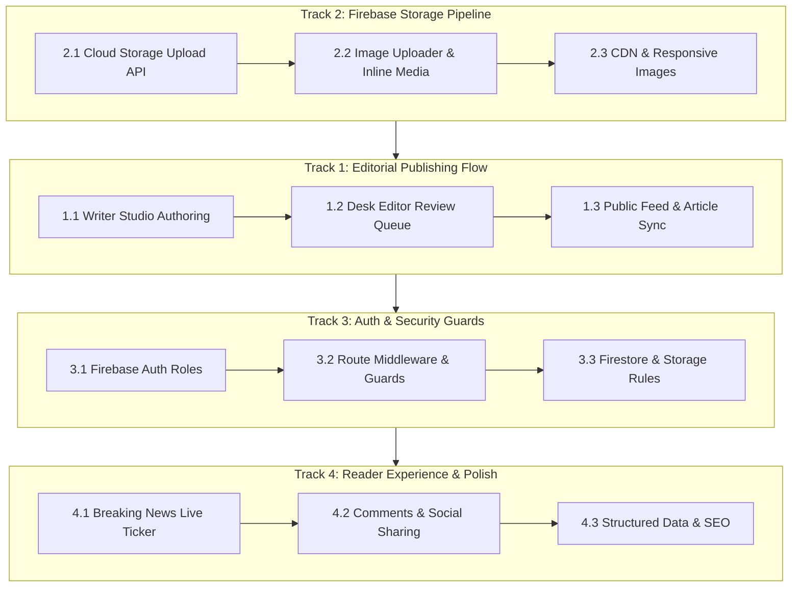

# 🧭 The Zango Platform — Implementation & Task Tracker

This tracker monitors the architecture, phase-by-phase implementation checklists, verification gates, and quality controls across the next key development tracks.



---

## 📋 Track 1: End-to-End Editorial Publishing Flow (Completed & Verified ✅)

### Objectives
Enable journalists to compose, tag, and submit manuscripts, allow desk editors to review and schedule publication, and guarantee instant synchronization across the public portal.

### Phase 1.1: Writer Studio Authoring & Submission
- [x] **Manuscript Form Validation**
  - Title, subtitle, excerpt, and slug auto-generation from title
  - Word count, character count, and estimated reading time computation
  - Category selection (Politics, Tech, Business, Culture, Opinion, Investigative)
  - Custom tag chip input with keyboard handling (Enter / comma)
- [x] **Draft Persistence & Auto-Save**
  - Local draft saving in `localStorage` to prevent work loss
  - Server draft saving via `/api/admin/submissions` with status `draft`
- [x] **Manuscript Submission**
  - Validation gate: require minimum title length (10 chars), excerpt, and content (40 words)
  - Submission transition to `pending` in Firestore `submissions` collection
  - Clear success modal with reference ID and link to track review status

### Phase 1.2: Desk Editor Review Queue & Quality Gate
- [x] **Editorial Review Queue ([editor/page.tsx](src/app/dashboard/editor/page.tsx))**
  - Tabbed filtering: `All`, `Pending Review`, `In Revision`, `Approved`
  - Quick manuscript preview drawer with side-by-side author metadata and tag chips
- [x] **Editorial Actions & Workflow Transitions**
  - **Approve & Publish**: Transition status to `approved` and persist to Firestore `articles`
  - **Schedule**: Date/time setting future `scheduledAt` timestamp
  - **Request Revision**: Attach structured editorial feedback notes sent back to author
  - **Reject**: Mark submission as rejected
- [x] **Editorial Overrides & Taxonomy Curation**
  - Toggle `isBreaking` (broadcast ticker flag)
  - Toggle `isFeatured`, `isTrending`, `isEditorsPick`, `isLatest`
  - Reassign primary category and customize story tags

### Phase 1.3: Real-Time Public Propagation
- [x] **Homepage & Category Sync**
  - Published articles immediately visible on [Home Page](src/app/page.tsx) without hard reload
  - Category views ([category/[slug]](src/app/category/[slug]/page.tsx)) reflect new articles
- [x] **Reader View Polish ([article/[slug]](src/app/article/[slug]/page.tsx))**
  - Verified live URL resolution with HTTP 200 for newly published articles
  - Verified author byline, publication timestamp, reading time badge, and category tag

---

## 🗄️ Track 2: Firebase Storage Media Upload Pipeline

### Objectives
Replace local base64 fallbacks with high-performance cloud storage on bucket `the-zango.firebasestorage.app`.

### Phase 2.1: Cloud Storage Service & API Handler
- [ ] **Firebase Admin / Client Storage Setup**
  - Verify Firebase Storage initialization in [src/lib/firebase/config.ts](src/lib/firebase/config.ts)
  - Configure `getStorage(app)` client instance and export `storage`
- [ ] **Direct Upload API Route ([/api/upload](src/app/api/upload/route.ts))**
  - Accept `multipart/form-data` with file payload
  - Validate mime types: `image/jpeg`, `image/png`, `image/webp`, `image/avif`
  - Enforce max file size: 5MB for hero images, 2MB for avatars
  - Generate collision-resistant storage path: `articles/{year}/{month}/{uuid}_{filename}`
  - Upload to Firebase Storage and return permanent public download URL

### Phase 2.2: UI Uploader Component Enhancement
- [ ] **Cover Image Uploader ([image-uploader.tsx](src/components/image-uploader.tsx))**
  - Drag-and-drop zone with visual feedback (hover/active state)
  - Client-side image compression / resizing (canvas / browser-image-compression)
  - Upload progress indicator percentage
  - Image cropping or aspect-ratio preview (16:9 for article hero)
- [ ] **Inline Media Insertion**
  - Toolbar button in Writer Studio rich editor to upload and insert images with captions

### Phase 2.3: Optimization & Security
- [ ] **Next.js Image Configuration ([next.config.ts](next.config.ts))**
  - Add `firebasestorage.googleapis.com` domain to `images.remotePatterns`
- [ ] **Storage Security Rules (`storage.rules`)**
  - Read access: public for all `/articles/**`
  - Write access: authenticated users with `author` or `editor` role

---

## 🔐 Track 3: Role-Based Authorization & Protected Route Guards

### Objectives
Enforce strict access controls so readers, contributors, desk editors, and administrators have appropriate access boundaries.

### Phase 3.1: Authentication & Role Architecture
- [ ] **Role Schema in Firestore (`users` collection)**
  - Schema:
    ```typescript
    interface UserProfile {
      uid: string;
      email: string;
      displayName: string;
      photoURL?: string;
      role: 'reader' | 'author' | 'editor' | 'admin';
      bio?: string;
      created_at: string;
      updated_at: string;
    }
    ```
  - Auto-create user profile on first sign-in (default role: `reader` or `author`)
- [ ] **Auth Context & Hook ([src/context/AuthContext.tsx](src/context/AuthContext.tsx))**
  - Sync Firebase `onAuthStateChanged` with Firestore user profile document
  - Provide `user`, `role`, `loading`, `signInWithEmail`, `signInWithGoogle`, `signOut`

### Phase 3.2: Protected Route Guards & Middleware
- [ ] **Client & Server Guarding**
  - Route `/dashboard/author` &rarr; Requires `author`, `editor`, or `admin`
  - Route `/dashboard/editor` &rarr; Requires `editor` or `admin`
  - Route `/dashboard/admin` &rarr; Requires `admin`
  - Graceful unauthorized redirect to `/login?callbackUrl=...` with informative toast

### Phase 3.3: Firestore Security Rules (`firestore.rules`)
- [ ] Declarative security rules for `articles`, `users`, `comments`, and `subscribers`:
  - `articles`: Public read for `status == 'published'`. Authors can create/edit own drafts. Editors/admins can update any article.
  - `users`: Users can read/write their own profile; admins can manage roles.

---

## ⚡ Track 4: Front Page & Reader Experience Polish

### Objectives
Deliver a world-class reading experience with live news dispatches, social sharing, and reader engagement.

### Phase 4.1: Live Breaking News Dispatch Ticker
- [ ] **Ticker Component ([breaking-news-ticker.tsx](src/components/breaking-news-ticker.tsx))**
  - Live Firestore subscription for articles where `is_breaking == true` and `status == 'published'`
  - Animated marquee or cycling transition with urgency pulse indicator
  - Click-through directly to the breaking article

### Phase 4.2: Reader Engagement
- [ ] **Social Sharing ([article-reader-toolbar.tsx](src/components/article-reader-toolbar.tsx))**
  - Native Web Share API with fallbacks:
    - WhatsApp direct share with formatted title + URL
    - X (Twitter) intent with pre-filled hashtags
    - LinkedIn share intent
    - One-click copy link with success tooltip
- [ ] **Local & Cloud Bookmarking**
  - Fast local storage bookmarking for guest readers
  - Dedicated "Saved Articles" drawer or reading list page

### Phase 4.3: Structured Data & Metadata
- [ ] Dynamic OpenGraph images and Twitter cards
- [ ] Schema.org `NewsArticle` JSON-LD on article pages for Google Discover and search indexing

---

## 🧪 Validation & Quality Gates

Every implementation task must satisfy the four-stage verification gate before committing:

```bash
# 1. Type verification
npx tsc --noEmit

# 2. Lint and format inspection
npm run lint

# 3. Production build compilation
npm run build

# 4. HTTP route check
curl -s -o /dev/null -w "%{http_code}\n" http://localhost:3002/
```

