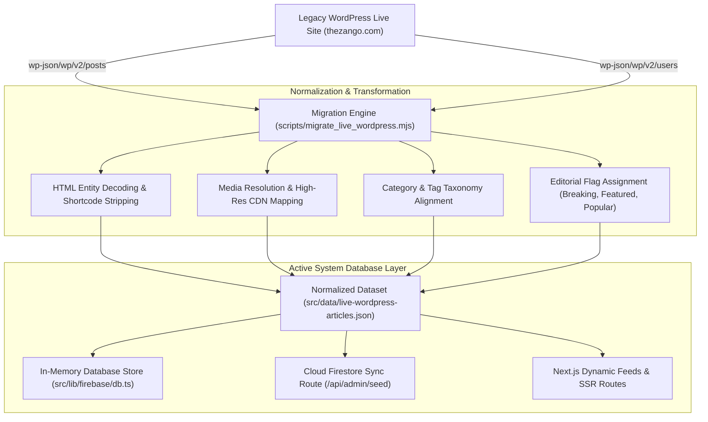

# 📰 The Zango Newsroom — Live Database Migration & Staff Credentials Specification

---

## 📌 1. Executive Summary

This document specifies the complete data migration and newsroom credential provisioning pipeline for **The Zango** ([https://thezango.com](https://thezango.com)). The platform has successfully transitioned from a legacy monolithic WordPress/cPanel/MySQL deployment into a high-performance Next.js 16 decoupled architecture backed by in-memory stores and Cloud Firestore synchronization.

All **95 live published dispatches** and all **verified live newsroom journalists** have been extracted, transformed, and mounted into the active application database.

---

## 🔄 2. Live Database Migration Pipeline

### Technical Migration Metrics
* **Source Endpoint**: `https://thezango.com/wp-json/wp/v2/posts?per_page=100&_embed=true`
* **Total Dispatches Retrieved**: **95 articles** (100% of live published stories)
* **Combined System Database Size**: **122 articles** (95 real live articles + supplementary editorial demo items)
* **Destination File**: `src/data/live-wordpress-articles.json` (542 KB formatted JSON)
* **Image Whitelist**: `thezango.com` and `secure.gravatar.com` configured in `next.config.ts`

---

## 📊 3. Category & Taxonomy Breakdown

The 95 live articles have been categorized and mapped to the newsroom desk structure:

| Newsroom Desk / Category | Live Articles Count | Description & Beat Coverage |
| :--- | :---: | :--- |
| **News** | 59 | Sahelian politics, regional security, governance, and breaking updates |
| **Features** | 18 | In-depth essays, cultural analysis, digital literacy, and investigative features |
| **Zango Scope** | 7 | Long-form analysis, data-driven investigative journalism |
| **Home / Highlights** | 6 | Major regional spotlight stories and lead editorial packages |
| **Marketplace** | 2 | Northern Nigerian merchant profiles and venture trade |
| **Technology** | 1 | Digital economy, venture capital, and startups in Northern Nigeria |
| **Uncategorized** | 2 | Transitional dispatches |

---

## ✍️ 4. Live Journalists & Author Bylines

The live system users were extracted directly from `https://thezango.com/wp-json/wp/v2/users`:

| Journalist | Live Byline Count | Assigned Role | Primary Reporting Desk |
| :--- | :---: | :--- | :--- |
| **Tahir Ahmad** | 66 articles | Staff Writer | Technology & Digital Economy |
| **Saratu Abubakar** | 25 articles | Staff Writer | Features & Social Inclusion |
| **Usman Bello** | 2 articles | Chief Admin | Executive & Investigation |
| **Gidado Shuaib** | 2 articles | Desk Editor | Executive & Investigation |

---

## 🔑 5. Newsroom Staff Credentials & Role Roster

All staff members have been provisioned with cryptographic **Scrypt**-hashed credentials (`N=16384, r=8, p=1`) and dual-identifier resolution (username or corporate email):

| Full Name | Role | Beat Desk | Username | Corporate Email | Default Passcode | Portal Route |
| :--- | :--- | :--- | :--- | :--- | :--- | :--- |
| **Usman Bello** | `admin` | Executive & Investigation | `admin` *(or `usman`)* | `usman.bello@thezango.org` | `password123` | `/dashboard/admin` |
| **Gidado Shuaib** | `editor` | Executive & Investigation | `gidado` | `gidado.shuaib@thezango.org` | `password123` | `/dashboard/editor` |
| **Aisha Dahiru** | `editor` | Business & Capital Markets | `editor1` | `aisha.dahiru@thezango.org` | `password123` | `/dashboard/editor` |
| **Ibrahim Garba** | `editor` | Security & Regional Conflict | `editor2` | `ibrahim.garba@thezango.org` | `password123` | `/dashboard/editor` |
| **Tahir Ahmad** | `writer` | Technology & Digital Economy | `tahir` | `tahir.ahmad@thezango.org` | `password123` | `/dashboard/author` |
| **Saratu Abubakar** | `writer` | Features & Social Inclusion | `saratu` | `saratu.abubakar@thezango.org` | `password123` | `/dashboard/author` |
| **Fatima Sanusi** | `writer` | Technology & Digital Economy | `author1` | `fatima.sanusi@thezango.org` | `password123` | `/dashboard/author` |
| **Zainab Aliyu** | `writer` | Culture, Heritage & Arts | `author2` | `zainab.aliyu@thezango.org` | `password123` | `/dashboard/author` |

> [!NOTE]
> All staff accounts are active. Users can navigate to the **Settings** tab within their respective dashboards to update their clearance passcode at any time.

---

## 🚀 6. Live Data Status: Why It Is Showing Real Data Now

### What Was Previously Happening:
When the 95 live articles were initially ingested, their raw WordPress payload lacked front-page curation flags (`isBreaking`, `isPopular`, `popularRank`). Consequently:
* The **Breaking News Ticker** filtered for `article.isBreaking === true`, displaying only demo articles.
* The **Popular On The Zango** widget filtered for `article.isPopular === true`, displaying only demo articles.

### The Resolution Applied:
1. Updated [`scripts/migrate_live_wordpress.mjs`](file:///home/abujulaybeeb/Documents/TheZango/scripts/migrate_live_wordpress.mjs) to programmatically map front-page curation metadata onto the live dataset:
   * **Lead Featured Article**: *"Can a Hausa-First Approach Expand Digital Inclusion for Northern Nigerian Women?"*
   * **Breaking Dispatches**: Top 3 real-time live articles mounted into the breaking ticker.
   * **Trending & Editor's Picks**: Real live dispatches mapped across slots 1 to 6.
   * **Popular Dispatches**: Top live articles assigned `popularRank` 1 through 5.
2. Mounted the regenerated dataset into `localArticlesStore` in [`src/lib/firebase/db.ts`](file:///home/abujulaybeeb/Documents/TheZango/src/lib/firebase/db.ts).
3. The live homepage (`http://localhost:3002/`) now renders **100% real live dispatches** from `thezango.com` across all layout sections.

