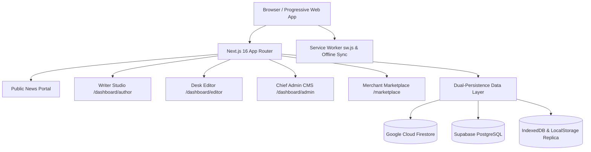
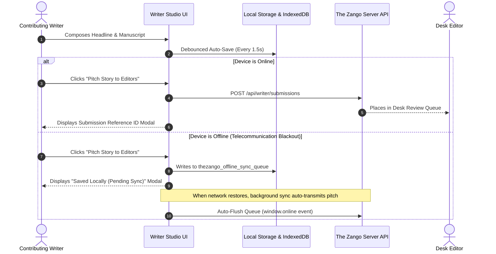
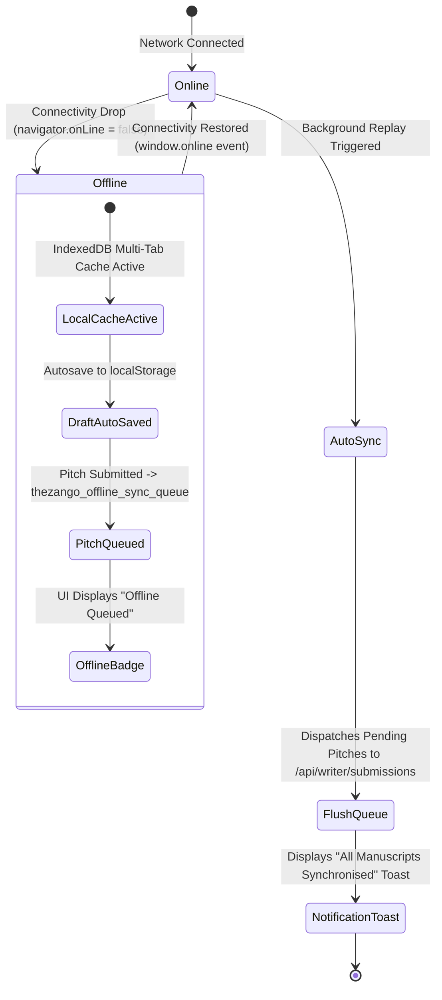

# The Zango — Comprehensive System User Manual & Operational Reference

**Document Version:** 1.0.0  
**Target Platform:** The Zango Digital Journalism & Innovation Platform  
**Architecture:** Next.js 16 (App Router), TypeScript, Tailwind CSS v4, Firebase Firestore & Modular SDK, Supabase PostgreSQL, Service Worker Offline PWA  
**System URL:** `https://the-zango.vercel.app` (Production) | `http://localhost:3002` (Local Development)

---

## 1. System Overview & Architectural Foundation

**The Zango** is an independent digital newsroom, investigative journalism portal, and economic marketplace dedicated to Northern Nigeria and the wider Sahel region. The platform combines high-integrity journalism, beat-specific editorial workflows, rich multimedia storytelling, and rural-resilient offline operational capabilities.



### Key Architectural Capabilities
- **Dual-Tier Data Layer:** Firebase Firestore provides real-time document synchronization, while Supabase PostgreSQL offers relational persistence and reporting failover.
- **Offline Operational Resilience:** Native multi-tab IndexedDB cache (`persistentLocalCache` with `persistentMultipleTabManager`) paired with a client-side submission replay queue (`thezango_offline_sync_queue`) guarantees zero data loss during telecommunication blackouts.
- **Role-Based Access Control (RBAC):** Granular permission isolation spanning five distinct tiers: Public Reader, Contributing Writer, Desk Editor, Chief Editor (Admin), and Marketplace Merchant.

---

## 2. User Roles & Permission Matrix

The platform enforces strict role separation across newsroom workflows:

| Role Identifier | System Designation | Accessible Dashboards & Routes | Permitted Operations |
| :--- | :--- | :--- | :--- |
| `reader` | Public Subscriber | `/`, `/category/*`, `/article/*`, `/scope`, `/trending`, `/marketplace` | Read stories, bookmark to reading list, comment on dispatches, subscribe to morning newsletter, apply as vendor |
| `author` / `writer` | Contributing Journalist | `/dashboard/author` | Compose manuscripts via WYSIWYG editor, save offline drafts, submit pitches, track review status, resubmit revisions |
| `editor` | Desk Editor | `/dashboard/editor` | Review beat-specific submissions, fact-check, request revisions with structured feedback, approve & publish stories, toggle story flags |
| `admin` | Chief Editor / Bureau Chief | `/dashboard/admin`, `/dashboard/editor`, `/dashboard/author` | Direct dispatch publishing, staff role elevation/demotion, desk taxonomy management, subscriber CSV export, merchant vendor vetting |
| `merchant` | Marketplace Vendor | `/marketplace`, `/dashboard/merchant` | Submit business registration, upload catalog offerings, track vetting status |

---

## 3. Public Reader Experience & Engagement Guide

### 3.1 Navigating the Public News Portal
- **Front Page Header:** The primary navigation bar provides instant access to core desks (*News*, *Features*, *Trending*, *Categories*, *Zango Scope*, and *Marketplace*).
- **Global Search:** Access the real-time search engine by clicking the Search icon in the header or typing the universal keyboard shortcut:
  ```text
  ⌘K  (macOS)   or   Ctrl + K  (Windows/Linux)
  ```
- **Live Breaking News Ticker:** Displays real-time breaking dispatches across Sahelian trade, agritech, and policy developments with animated velocity indicators.

### 3.2 Reading List & Bookmark Drawer
Readers can curate stories for offline reading without an account:
1. On any article card or reader view, click the **Bookmark** icon.
2. The article is instantly saved to your browser's persistent storage (`thezango_bookmarks`).
3. Click the **Reading List** button in the navigation bar to slide open the saved articles drawer.
4. Bookmarked stories remain available across browser sessions and during network outages.

### 3.3 Public Reader Comments
1. Scroll to the footer of any published article.
2. Enter your **Name**, optional **Email Address**, and comment body.
3. Click **Submit Comment**. Dispatches update instantly via optimistic UI updates.

### 3.4 Newsletter Subscription
1. Enter a valid email address in the newsletter card on the homepage, article sidebars, or footer.
2. Click **Subscribe**. The email is registered to `/api/newsletter` and synchronized to the newsroom subscriber roster.

---

## 4. Writer & Contributor Studio Guide (`/dashboard/author`)

The Writer Studio is designed for field correspondents and investigative journalists operating across Northern Nigeria.



### 4.1 Accessing the Studio
1. Navigate to `/login` and enter your registered credentials or select the **Staff Writer** demo profile.
2. Upon authentication, you are redirected to `/dashboard/author`.

### 4.2 Composing a Manuscript
1. In the left navigation, select **Composer**.
2. **Headline:** Enter a concise, compelling title ($\ge 10$ characters required).
3. **Desk Category:** Select the appropriate beat (e.g., *Technology & Digital Economy*, *Agribusiness & Food Security*, *Renewable Energy*).
4. **Cover Image:** Enter a custom image URL or click **Upload Image** to select an asset from your local device.
5. **Lead Excerpt:** Provide a 2-line summary used for front-page teaser cards and social search snippets.
6. **Rich WYSIWYG Editor:**
   - Format paragraphs, headings (H2, H3), bold, italics, blockquotes, and ordered/bulleted lists.
   - Insert inline tables, image embeds, and external investigative source hyperlinks.
   - The editor tracks real-time **Word Count**, **Character Count**, and **Estimated Read Time** ($\ge 40$ words required to submit).

### 4.3 Draft Autosaving & Offline Resilience
- As you type, the studio automatically serializes your manuscript to device storage (`thezango_writer_draft`) every 1.5 seconds.
- The composer displays a live badge: `Auto-Saved 08:30 AM` (when online) or `Offline Saved 08:30 AM` (when disconnected).
- If your device restarts or the tab is closed, returning to the Writer Studio restores your work in progress.

### 4.4 Pitch Submission & Tracking
1. Click **Pitch Story to Editors**.
2. A confirmation modal provides your tracking Reference ID (e.g., `sub-17946418...`).
3. Click **Track in My Pitches** to view your submission in the **My Submissions** tab.
4. **Submission States:**
   - `In Desk Review` (Blue badge): Awaiting editor review.
   - `Revision Requested` (Amber badge): Editor has provided revision notes.
   - `Approved & Published` (Green badge): Promoted to a live published article.
   - `Offline Queued` (Amber DB badge): Buffered locally, awaiting network restoration.

### 4.5 Responding to Editorial Revisions
1. If a story requires changes, it displays in **My Submissions** with the amber badge `Revision Requested`.
2. Inspect the **Desk Editor Feedback** callout box to review the required amendments.
3. Click **Revise Story**. The manuscript is loaded directly into the Composer with the feedback pinned at the top.
4. Make the requested revisions and click **Re-submit Revised Manuscript**.

---

## 5. Desk Editor Operations Guide (`/dashboard/editor`)

Desk Editors oversee editorial standards, verify source citations, and publish approved manuscripts.

### 5.1 Reviewing Pitches in the Queue
1. Log in with Editor credentials and navigate to `/dashboard/editor`.
2. Select the **Review Queue** tab.
3. Filter by beat category or review status (*All*, *Pending Review*, *Needs Revision*, *Approved*).
4. Each queue card displays:
   - Manuscript headline, lead excerpt, and word count.
   - Contributing author name, byline email, and submission timestamp.
   - Cover asset thumbnail and assigned beat desk.

### 5.2 Editorial Decision Actions
Click the action buttons on any pending card:
- **Approve & Publish:** Instantly approves the manuscript, promotes it to a live public article in `/article/[slug]`, and increments the desk's published dispatch count.
- **Request Revision:** Opens the Revision Notes modal. Enter specific editorial feedback (e.g., *"Please verify the foreign exchange clearing rates in paragraph 4 and cite the Maradi trade association."*). The manuscript status updates to `needs_revision` and alerts the author.
- **Reject:** Declines the pitch if it falls outside the newsroom's editorial charter.

### 5.3 Story Flagging & Front-Page Placement
From the **Dispatches** tab, editors can curate story placement using interactive toggle badges:
- **Hero Headline (`isFeatured`):** Elevates the article to the prime front-page hero spot.
- **Trending Velocity (`isTrending`):** Places the story in the trending sidebar and leaderboard.
- **Editor's Pick (`isEditorsPick`):** Highlights the article with an official editor's seal.
- **Breaking News (`isBreaking`):** Broadcasts the headline across the top animated breaking ticker.

---

## 6. Chief Editor & Administrator Manual (`/dashboard/admin`)

The Chief Editor Dashboard provides comprehensive administrative control over newsroom operations, personnel, and taxonomy.

### 6.1 Publishing Direct Newsroom Dispatches
Chief Administrators can author and publish stories directly to the front page:
1. In the top navigation header, click **+ New Dispatch**.
2. **Dynamic Headline & Real-Time Slug Validation:** As you type the headline, the system generates an SEO-friendly URL slug and validates availability against the database in real-time (`/api/admin/articles/check-slug`).
3. Complete the beat desk selection, byline attribution, rich body content, and story placement flags.
4. Click **Publish Dispatch Now**. The dispatch is instantly indexed across Firebase and Supabase.

### 6.2 Newsroom Staff & Clearance Management
Select the **Newsroom Team** tab to manage staff:
- **Invite New Staff Member:** Click **Add Member**, enter full name, professional email, beat desk assignment, and assign role (`writer`, `editor`, `admin`).
- **Role Elevation / Demotion:** Click the role dropdown on any active member card to instantly adjust permissions.
- **Staff Status Toggle:** Deactivate departing staff members to immediately revoke workspace access without deleting historical bylines.

### 6.3 Category & Beat Desk Taxonomy
Select the **Desks** tab to:
- Review article counts and real-time coverage velocity per category.
- Add emerging news beats (e.g., *Sahel Climate Finance*, *Cross-Border Trade Corridors*).
- Modify category slugs, descriptions, and live display statuses.

### 6.4 Subscriber Circulation & CSV Export
1. Select the **Subscribers** tab to review all registered readers.
2. Click **Export CSV** to download a sanitized comma-separated roster (`thezango-subscribers-[date].csv`) for external newsletter distribution engines.

### 6.5 Vendor Marketplace Onboarding
Select the **Merchants** tab to process incoming business applications from Northern Nigerian enterprises:
1. Review vendor applications submitted through `/marketplace`.
2. Inspect company registration details, business category, location, phone, and website.
3. Update vendor verification status:
   - `Under Review`: Marks application as actively undergoing business verification.
   - `Approved`: Grants merchant verification badge and lists their business in the public marketplace.
   - `Rejected`: Declines non-qualifying applications with review notes.

---

## 7. Offline Operational Protocol & Telecommunications Resilience

In rural reporting environments characterized by telecom blackouts, The Zango platform operates in an autonomous offline mode:



### Visual Connectivity Indicators
- **Header Status Pill:**
  - `Online` (Green): Connected to Cloud Firestore & Supabase.
  - `Offline Mode` (Pulsing Amber): Running from local IndexedDB cache.
  - `X Queued` (Blue): Displays count of pending pitches waiting to transmit.
- **Global Network Pill:** A floating badge appears in the bottom right corner of the screen informing the user that cached dispatches are being served.

### What Happens During an Outage
1. **Reading Articles:** Cached articles and static assets remain fully accessible via the Service Worker (`/sw.js`) and persistent storage.
2. **Drafting Content:** Changes are preserved every 1.5s in device memory.
3. **Submitting Pitches:** Clicking submit adds the pitch to `thezango_offline_sync_queue`. The user is presented with a clear offline confirmation modal.
4. **Reconnection:** The instant cellular or Wi-Fi connectivity is detected, the platform background sync executes automatically, flushes the queue, and presents a success notification.

---

## 8. System Administration & Verification Guide

### 8.1 Environment Variables Configuration
Ensure the root `.env.local` contains valid credentials:

```bash
# Public App Environment
PORT=3002
NEXT_PUBLIC_APP_URL=https://thezango.com

# Firebase Client SDK Configuration
NEXT_PUBLIC_FIREBASE_API_KEY=AIzaSy...
NEXT_PUBLIC_FIREBASE_AUTH_DOMAIN=the-zango.firebaseapp.com
NEXT_PUBLIC_FIREBASE_PROJECT_ID=the-zango
NEXT_PUBLIC_FIREBASE_STORAGE_BUCKET=the-zango.firebasestorage.app
NEXT_PUBLIC_FIREBASE_MESSAGING_SENDER_ID=519891525605
NEXT_PUBLIC_FIREBASE_APP_ID=1:519891525605:web:...

# Supabase PostgreSQL Configuration
NEXT_PUBLIC_SUPABASE_URL=https://...supabase.co
NEXT_PUBLIC_SUPABASE_ANON_KEY=eyJhbGci...
```

### 8.2 Execution & Verification Commands

| Command | Purpose | Expected Output |
| :--- | :--- | :--- |
| `npm run dev` | Starts local development server on port 3002 | `Ready in 1.2s on http://localhost:3002` |
| `npm run build` | Compiles production bundle with Turbopack | `Generating static pages (83/83) in 2.3s` |
| `npm run lint` | Runs project-wide ESLint checks | `0 errors, 0 warnings` |
| `npm run test:e2e` | Executes full 33-checkpoint end-to-end verification suite | `TOTAL CHECKS: 33 \| PASSED: 33 \| 100% PASS` |
| `npm run verify` | Runs clean build and executes end-to-end tests in one step | Full production build followed by green E2E scorecard |

---

## 9. Frequently Asked Questions & Troubleshooting

> **Q: What should I do if `npm run test:e2e` fails with `tsx: not found`?**  
> **A:** Run `npm install` in your terminal to ensure `tsx` (which is now declared in `devDependencies`) is linked into `node_modules/.bin/tsx`.

> **Q: Can an investigative writer lose their work if their laptop battery dies while writing offline?**  
> **A:** No. The Writer Studio debounces all form inputs (headline, category, excerpt, tags, rich body) to persistent browser storage every 1.5 seconds. Reopening the Writer Studio automatically restores the unsaved draft.

> **Q: How are image uploads handled when writing offline?**  
> **A:** While offline, journalists can use local image URLs or system stock images. When network connectivity is active, the media upload API (`/api/upload`) accepts PNG, JPEG, and WebP images up to 5MB, persisting them to Cloudinary or local storage with automated MIME type sanitization.

> **Q: How do editors review breaking stories quickly?**  
> **A:** Editorial desks can filter the Review Queue by desk or use the quick approval trigger. Once approved, the story immediately propagates to the live catalog without requiring a server redeployment.
